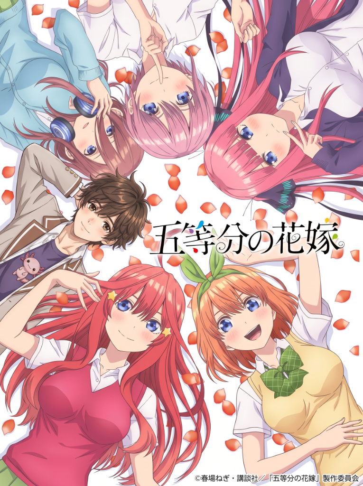

  

<h1 align="center">Go-Tōbun no Hanayome</h1>

<h2 align="center">The Fujioka Variable (Original Light Novel) 🇲🇽❤️🇯🇵</h2>

<em>Una novela ligera original inspirada en el universo de <strong>Go-Tōbun no Hanayome</strong> (The Quintessential Quintuplets).</em>

<strong>Historia de fan original escrita con cariño desde México para el mundo. 🇲🇽❤️🇯🇵</strong>

---

### 📖 Acerca de

**The Fujioka Variable** sigue una línea alternativa donde un nuevo personaje, Fujioka, entra en la vida de las quintillizas Nakano y cambia el rumbo de la historia que creías conocer.

### 📚 Contenido

- Capítulos de la novela ligera
- Notas del autor
- Ilustraciones y arte conceptual
- 🎨 [Arte oficial del anime](arte-oficial/README.md)

---

*Proyecto de fan, sin fines de lucro. Go-Tōbun no Hanayome es propiedad de Negi Haruma / Kodansha.*
