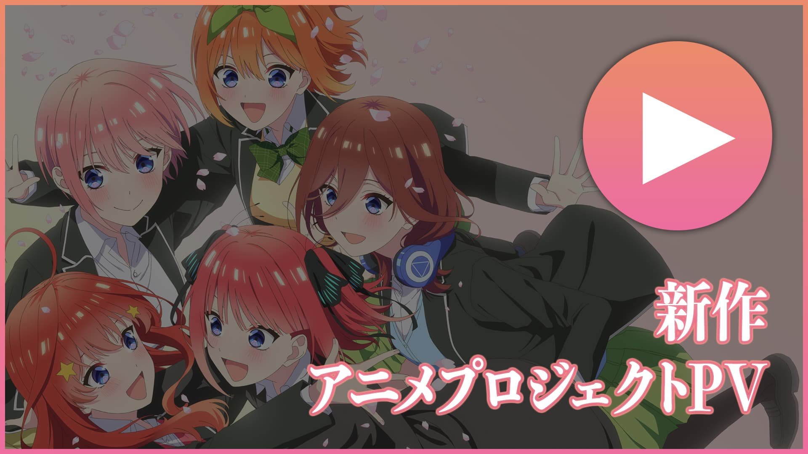
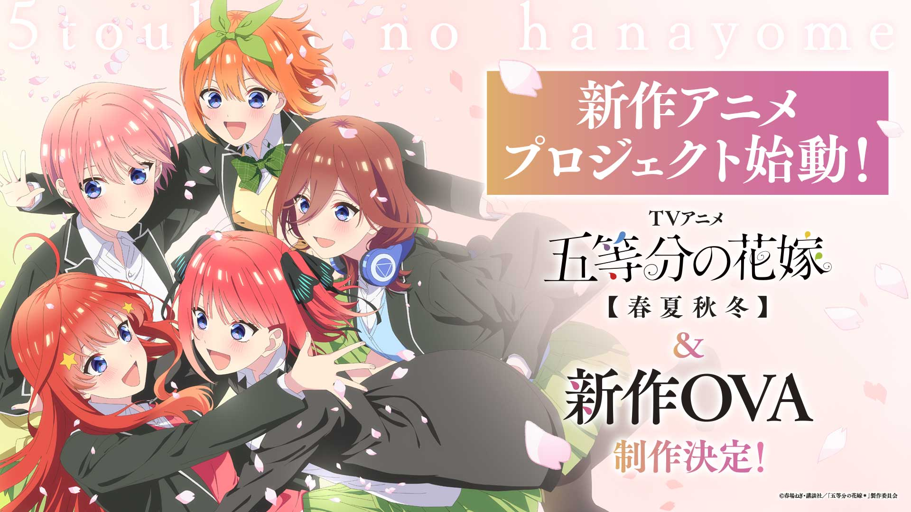
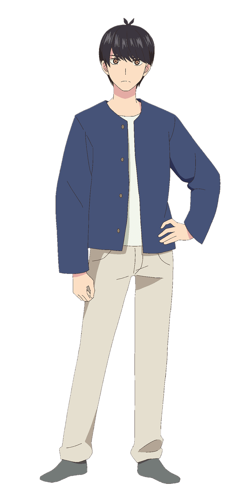
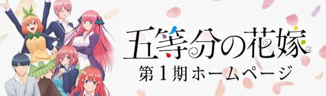
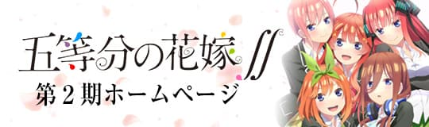
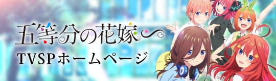
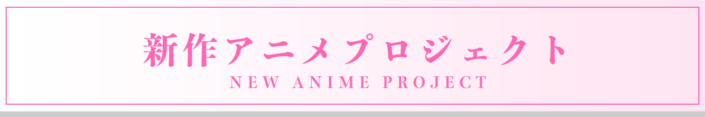

# 🎨 Arte Oficial del Anime

Arte y visuales oficiales de *Go-Tōbun no Hanayome* (The Quintessential Quintuplets), obtenidos del sitio oficial del anime de TBS.

---

## 🎬 Visuales Principales

### Visual de la Película

### Visual Promocional 2026

---

## 👧 Arte de Personajes

### Imagen Grupal de las Quintillizas

---

## 📺 Banners de las Temporadas

| Temporada | Banner |
|---|---|
| **Temporada 1** (2019) |  |
| **Temporada 2** ∫ (2021) |  |
| **Especial de TV** (2022) |  |
| **La Película** (2022) |  |
| **Del original (春場ねぎ)** |  |

### Banner del Proyecto (sitio oficial)

---

## ⚖️ Atribución y Derechos

Todo el arte mostrado en esta carpeta es material **oficial y promocional** obtenido del [sitio oficial del anime de TBS](https://www.tbs.co.jp/anime/5hanayome/).

> ©春場ねぎ・講談社／「五等分の花嫁」製作委員会
> © Negi Haruma / Kodansha / Comité de Producción de "Go-Tōbun no Hanayome"

Este repositorio es un **proyecto de fan sin fines de lucro**. El arte oficial se incluye únicamente con fines de referencia y admiración, y todos los derechos pertenecen a sus respectivos autores y comités de producción.
