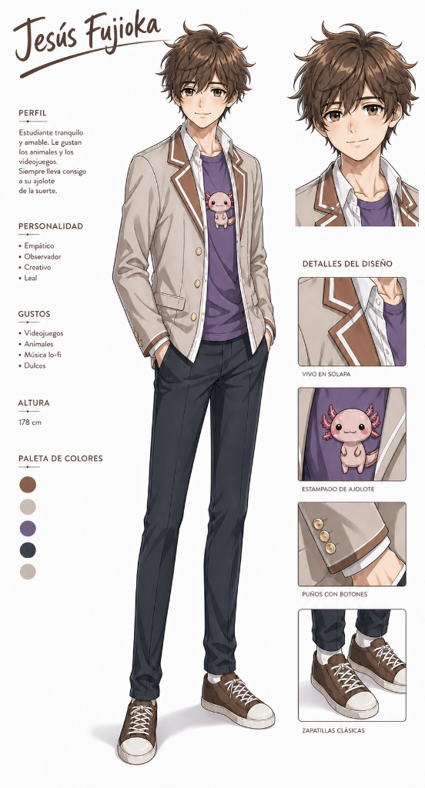
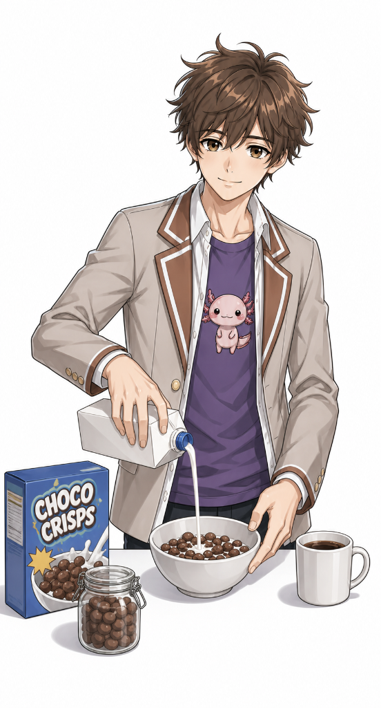
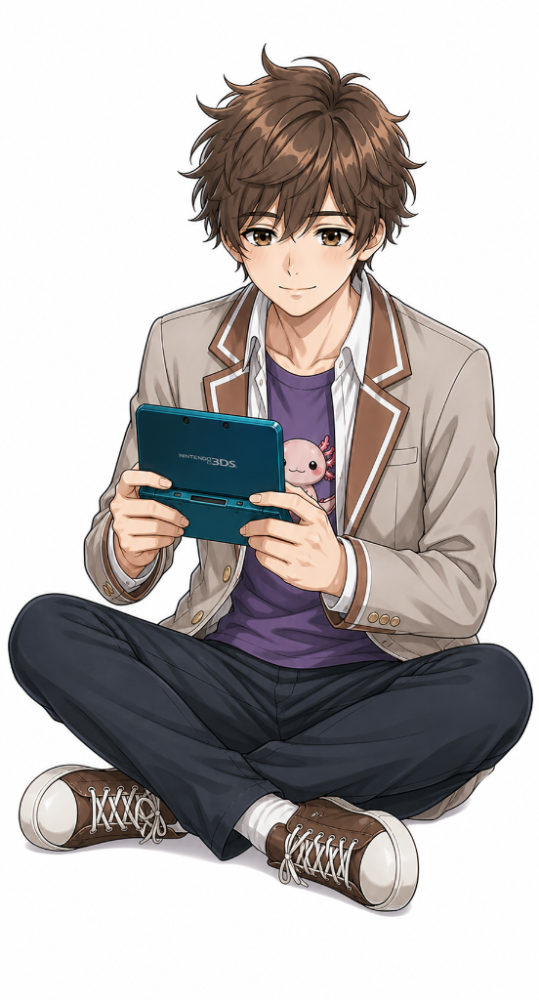
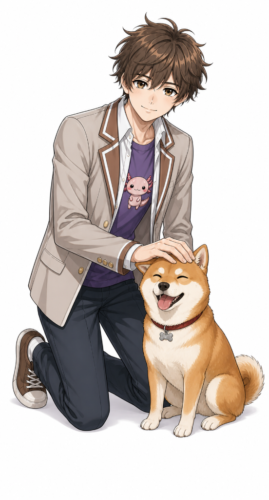
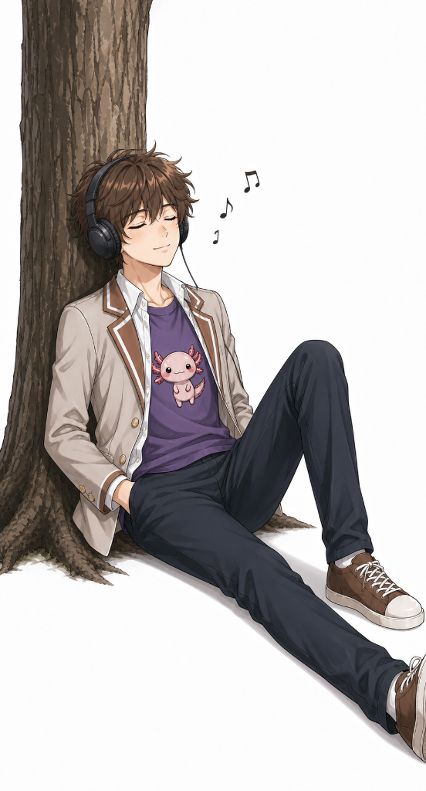

# 👤 Jesús Fujioka Hernández

<em>El personaje original de <strong>The Fujioka Variable</strong> — la variable que cambia todo. 🇲🇽❤️🇯🇵</em>

  

---

## 📋 Perfil

> Estudiante tranquilo y amable. Le gustan los animales y los videojuegos. Siempre lleva consigo a su ajolote de la suerte.

| | |
|---|---|
| **Nombre completo** | Jesús Fujioka Hernández |
| **Altura** | 178 cm |
| **Ojos / Cabello** | Café / Café alborotado |
| **Señal de identidad** | Su ajolote de la suerte 🦎 |

### Personalidad

- Empático
- Observador
- Creativo
- Leal

### Gustos

- Videojuegos 🎮
- Animales 🐕
- Música lo-fi 🎧
- Dulces 🍫

### Paleta de colores del diseño

| | | | | |
|---|---|---|---|---|
| 🟫 Cafe | 🟠 Piel clara | 🟣 Morado | ⚫ Azul marino | ⬜ Crema |
| `#8D6E63` | `#F5D3C5` | `#7B5C8E` | `#373D47` | `#DDD0C5` |

---

## 🖼️ Galería de Arte Oficial del Personaje

### 🥣 El desayuno de siempre

Jesús sirviendo leche en su bowl de Choco Crisps. La rutina matutina de todo estudiante.

### 🎮 Hora de jugar

Sentado en el piso con su consola portátil. Los videojuegos son su escape favorito.

### 🐕 Mejor amigo canino

No hay mejor terapia que arreglarle el pelaje a un Shiba Inu feliz.

### 🎧 Momentos lo-fi

Relajándose bajo un árbol con sus audífonos y su música lo-fi favorita.

---

*Personaje original de **The Fujioka Variable**. Proyecto de fan, sin fines de lucro.*
